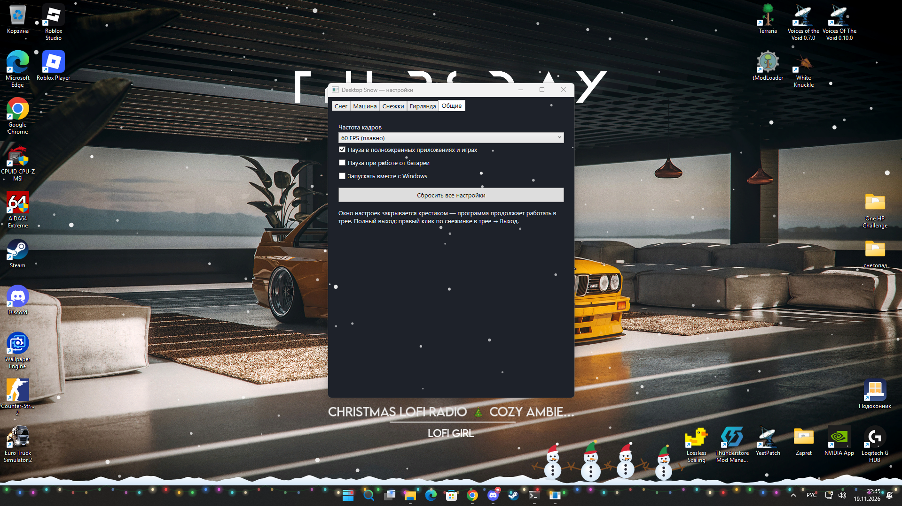
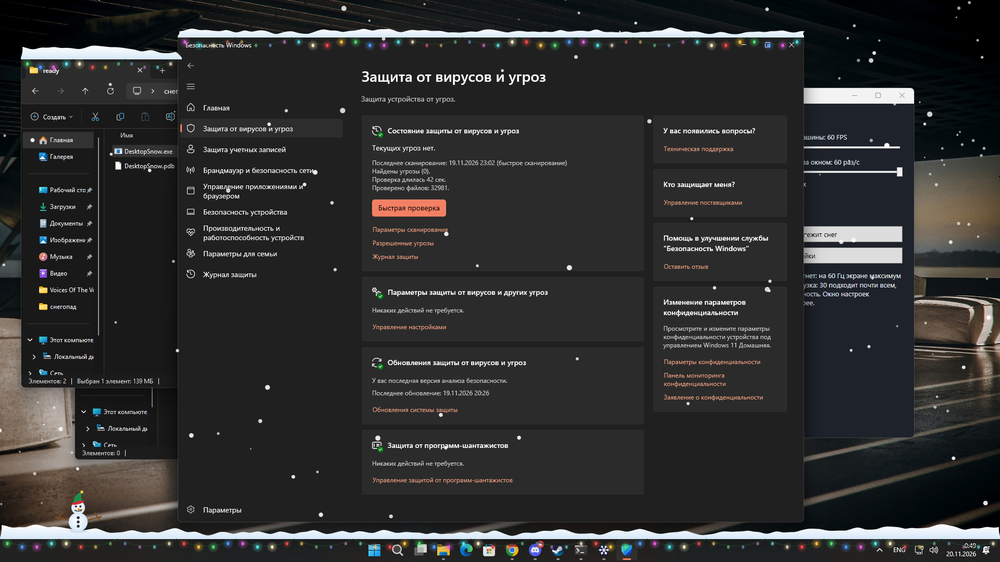

# ❄️ FrostByte

**Снегопад на рабочем столе Windows.** Снег ложится сугробами на окна и панель задач, приезжает снегоуборочная машина и сметает его, из снежков лепятся снеговики, а по кромкам окон горит разноцветная гирлянда.

---

## Что умеет

- 🌨 **Снегопад** поверх всех окон — клики и работа при этом не блокируются вообще
- 🏔 **Сугробы** растут на верхних кромках окон и на панели задач, едут вместе с окнами и осыпаются, когда окно закрывают
- 🚜 **Снегоуборочная машина** приезжает сама, когда снега накопилось много: мигающий маячок, вращающиеся колёса, фонтан снежной крошки из ковша
- ⛄ **Снежки и снеговики**: слепил ком, покатал его по сугробу — он растёт, поставил один на другой — получился снеговик с пуговицами, палками-руками, морковкой и новогодней шапкой
- 🎄 **Гирлянда** на окнах и панели задач: 4 режима мигания, 7 цветов, живое свечение
- ⚙️ **Около 40 настроек** в трее, применяются мгновенно
- 🖥 Несколько мониторов, любой масштаб DPI, автопауза в играх и полноэкранных видео

## Управление

| Действие | Результат |
|---|---|
| ЛКМ по сугробу | слепить маленький снежок |
| держать ЛКМ и водить по снегу | ком катится и растёт, под ним остаётся дорожка |
| ЛКМ по снежку | поднять и перенести |
| отпустить снежок над другим | сложить снеговика |
| ЛКМ по снеговику | взять целиком и переставить на любое окно |
| ПКМ по снеговику | разобрать обратно на 2 снежка |
| Shift + ПКМ по снеговику | рассыпать совсем |
| ПКМ по снежку | убрать снежок |
| иконка в трее | настройки, пауза, вызвать машину, очистить снег, ярлык, выход |

## Скачать и запустить

1. Открой **[Releases](https://github.com/SHWWEEPS/FrostByte/releases/latest)** и скачай `FrostByte.exe`
2. Двойной клик — снег пошёл. Установка не нужна, .NET ставить не надо
3. Правый клик по снежинке в трее → **«Создать ярлык на рабочем столе»**

Windows покажет синее окно SmartScreen («неизвестный издатель») — это потому, что exe без платной цифровой подписи. Нажми **Подробнее → Выполнить в любом случае**.

**Требования:** Windows 10 (1703+) или Windows 11, x64.

## Собрать из исходников

Нужен [.NET 8 SDK](https://dotnet.microsoft.com/download/dotnet/8.0).

    git clone https://github.com/SHWWEEPS/FrostByte.git
    cd FrostByte
    dotnet run -c Release

Готовый одиночный exe (самодостаточный, .NET не требуется):

    dotnet publish -c Release -r win-x64 --self-contained true -p:PublishSingleFile=true -p:IncludeNativeLibrariesForSelfExtract=true -o ready

## Как это работает

- **C# .NET 8 + WPF.** Вся графика — вектор, рисуется кодом. Ни одной картинки в проекте.
- **Оверлей** — одно прозрачное окно на весь виртуальный экран с флагами `WS_EX_LAYERED`, `WS_EX_TRANSPARENT`, `WS_EX_TOOLWINDOW`, `WS_EX_NOACTIVATE`: поверх всего, но полностью «сквозное» для мыши и клавиатуры. Per-Monitor V2 DPI.
- **Окна** отслеживаются через `EnumWindows` и `DwmGetWindowAttribute(EXTENDED_FRAME_BOUNDS)` с учётом Z-порядка: если кромку окна перекрывает другое окно — снег и гирлянда там не рисуются.
- **Снег** — пул частиц плюс карта высот на каждую поверхность (ячейки по 6 px) с «лавинным» пересыпанием, чтобы сугроб имел естественный скруглённый профиль.
- **Ввод** — низкоуровневый хук `WH_MOUSE_LL`, который всегда вызывает `CallNextHookEx`. Программа только смотрит на клики, но никогда их не перехватывает.
- **Полноэкранный режим** определяется по всем окнам сверху вниз: мелкие пропускаются, первое крупное решает. Задержка скрытия снега около 0.05 секунды.
- **Настройки** — JSON в `%APPDATA%\FrostByte\settings.json`.

## Производительность и приватность

- Примерно 150–250 МБ ОЗУ, несколько процентов CPU
- Два ползунка: **частота кадров** (15–144 FPS) и **слежение за окнами** (2–60 раз в секунду) — можно настроить под свой компьютер
- Автопауза в полноэкранных играх и видео, опционально — при работе от батареи
- **Нет** сети, телеметрии, прав администратора, внедрения в чужие процессы
- Некоторые антивирусы не любят глобальный хук мыши (он нужен для снежков). Это ложное срабатывание из-за самого факта хука, а не из-за поведения программы

## Ограничения

- Только Windows
- Нет звуков
- Снеговик лепится из 2 шаров (из 3 с шарфом — в планах)
- Снег не накапливается на шапке снеговика
- exe без цифровой подписи, поэтому SmartScreen предупреждает

## Планы

- [ ] Звуки: хруст снега, дизель машины
- [ ] Снеговик из 3 шаров с шарфом
- [ ] Горячие клавиши
- [ ] Английский интерфейс
- [ ] Исключения для отдельных окон
- [ ] Снег на шапке снеговика

## Автор

Мне 14, это мой первый проект. Сделан за один вечер: идея, механики, тестирование и упорство — мои, код писался вместе с ИИ-ассистентом. Хотелось удивить класс и сделать себе зимний рабочий стол. Получилось.

## Лицензия

MIT — делай что хочешь, только оставь упоминание автора.

---
---

# ❄️ FrostByte — English

**Snowfall for your Windows desktop.** Snow piles up on window edges and the taskbar, a snowplow drives in and clears it, snowballs roll and grow into snowmen, and a colorful garland glows along your windows.

## Features

- 🌨 Snow falls over every window — **without blocking a single click**
- 🏔 Snowdrifts grow on window top edges and the taskbar, follow windows as you drag them, and crumble when a window closes
- 🚜 A **snowplow** arrives on its own once enough snow piles up: flashing beacon, spinning wheels, snow spray from the blade
- ⛄ **Snowballs and snowmen**: make a small ball, roll it over the snow to grow it, stack two — get a snowman with coal buttons, stick arms, a carrot nose and a Christmas hat
- 🎄 **Garland** on windows and the taskbar: 4 animation modes, 7 colors, soft glow
- ⚙️ About 40 settings in the tray, applied instantly
- 🖥 Multi-monitor, per-monitor DPI, auto-pause in fullscreen games and video

## Controls

| Action | Result |
|---|---|
| LMB on a snowdrift | make a small snowball |
| hold LMB and move over snow | the ball rolls, grows and leaves a trail |
| LMB on a snowball | pick it up and move it |
| drop a ball onto another | build a snowman |
| LMB on a snowman | pick up the whole snowman, place it on any window |
| RMB on a snowman | take it apart into 2 snowballs |
| Shift + RMB on a snowman | crumble it completely |
| RMB on a snowball | remove that ball |
| tray icon | settings, pause, call plow, clear snow, create shortcut, exit |

## Download

1. Get `FrostByte.exe` from **[Releases](https://github.com/SHWWEEPS/FrostByte/releases/latest)**
2. Double-click. No install, no .NET runtime needed
3. Right-click the tray snowflake → **"Create desktop shortcut"**

SmartScreen will warn about an unknown publisher because the exe is unsigned. Click **More info → Run anyway**.

**Requires:** Windows 10 (1703+) or Windows 11, x64.

## Build from source

Install the [.NET 8 SDK](https://dotnet.microsoft.com/download/dotnet/8.0), then:

    git clone https://github.com/SHWWEEPS/FrostByte.git
    cd FrostByte
    dotnet run -c Release

Single self-contained exe:

    dotnet publish -c Release -r win-x64 --self-contained true -p:PublishSingleFile=true -p:IncludeNativeLibrariesForSelfExtract=true -o ready

## How it works

- **C# .NET 8 + WPF**, all graphics drawn as vectors in code — zero image assets
- **Overlay**: one transparent window covering the virtual screen with `WS_EX_LAYERED`, `WS_EX_TRANSPARENT`, `WS_EX_TOOLWINDOW`, `WS_EX_NOACTIVATE` — always on top, fully click-through, Per-Monitor V2 DPI aware
- **Window tracking**: `EnumWindows` plus `DwmGetWindowAttribute(EXTENDED_FRAME_BOUNDS)`, Z-order aware occlusion so snow and garlands never bleed onto covering windows
- **Snow**: particle pool plus a per-surface heightmap (6 px cells) with avalanche relaxation for a natural rounded drift profile
- **Input**: a `WH_MOUSE_LL` hook that always calls `CallNextHookEx` — it observes clicks, never swallows them
- **Fullscreen detection**: all windows are scanned top-down, small ones are skipped, the first large one decides. Snow hides in about 0.05 seconds
- **Settings**: JSON at `%APPDATA%\FrostByte\settings.json`

## Performance and privacy

- Around 150–250 MB RAM, a few percent CPU
- Two sliders: **frame rate** (15–144 FPS) and **window tracking rate** (2–60 Hz)
- Auto-pause in fullscreen games and video, optional pause on battery
- **No** network, telemetry, admin rights, or injection into other processes
- Some antivirus tools flag global mouse hooks. It is a false positive caused by the hook itself, not by anything the app does

## Limitations

Windows only · no sounds · snowmen from 2 balls only · unsigned exe, so SmartScreen warns

## Roadmap

- [ ] Sounds: snow crunch, plow engine
- [ ] Three-ball snowman with a scarf
- [ ] Hotkeys
- [ ] English UI
- [ ] Per-window exclusions
- [ ] Snow on the snowman's hat

## Author

I'm 14 and this is my first project, built in one evening. The idea, mechanics, testing and stubbornness are mine; the code was written together with an AI assistant. I wanted to surprise my class and give myself a winter desktop. It worked.

## License

MIT
